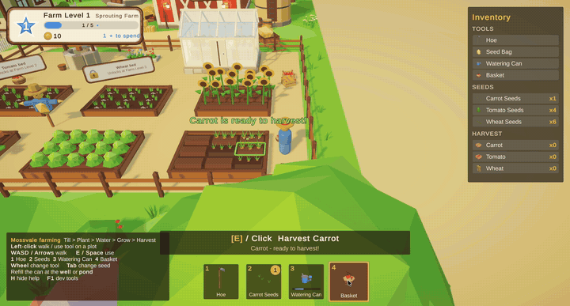
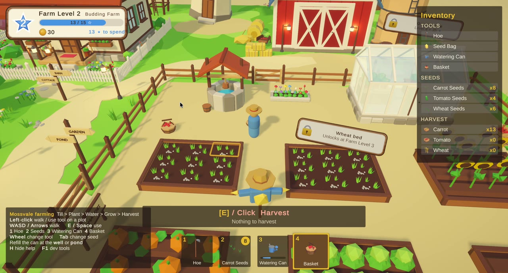
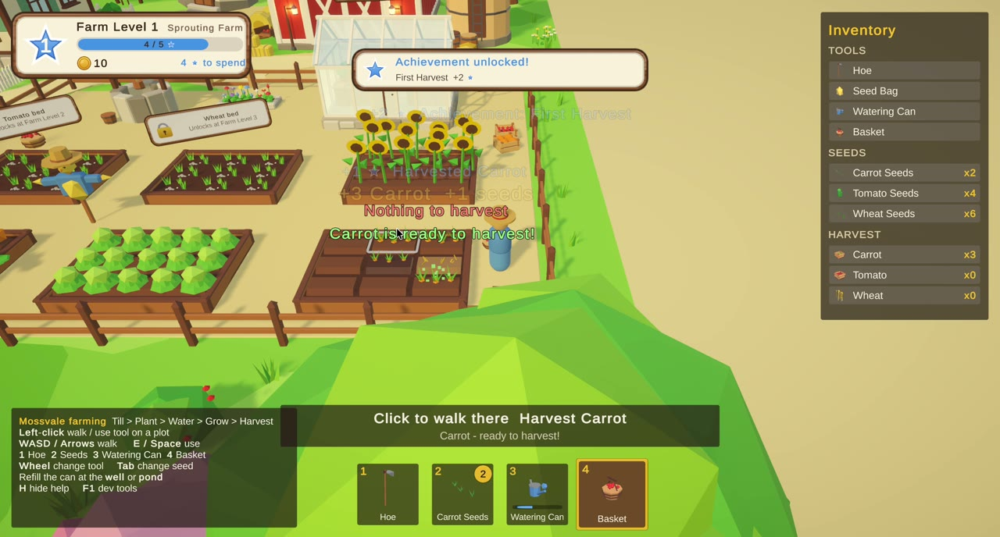
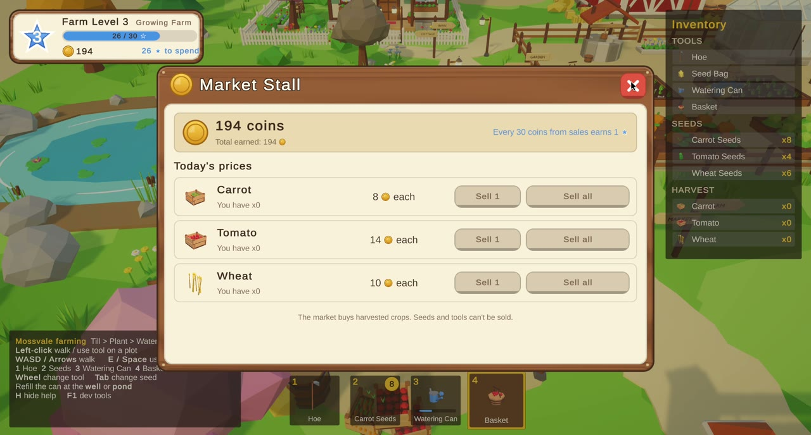
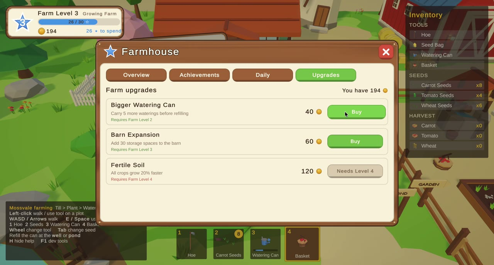

<div align="center">

# 🌱 Mossvale

**A cozy low-poly farming game. Till, plant, water and harvest your way from a sprouting plot to a thriving valley.**



### [⬇️ Download the game (macOS)](https://github.com/smritinukula16/mossvale/releases/latest) &nbsp;·&nbsp; [▶️ Watch full gameplay](https://github.com/smritinukula16/mossvale/releases/latest/download/Mossvale_Gameplay.mp4)


</div>

---

## 📸 Screenshots

| The farm | Harvest time |
|:---:|:---:|
|  |  |
| **Market stall** | **Farmhouse upgrades** |
|  |  |

---

## ✨ Features

**Farming loop**
- 🌾 The full cycle: **till → plant → water → grow → harvest**, with carrots, tomatoes and wheat.
- 🧰 Four tools (hoe, seed bag, watering can, basket). Refill the can at the **well** or the **pond**.
- 🪙 Sell your harvest at the **market stall**, and store produce in the **barn**.

**Progression**
- ⭐ Earn stars to grow your farm from *Sprouting Farm* to *Bountiful Farm*. Each level unlocks new crop beds and the **greenhouse**.
- 🏠 The **farmhouse** holds an overview, achievements, daily objectives and upgrades (bigger watering can, barn expansion, fertile soil).
- 💎 Spend stars to restore the **Heart of Mossvale**, a crystal that grows from a withered sapling to a radiant heart.
- 💾 Progress saves automatically between sessions.

**World and feel**
- 🏡 A hand-built 50 × 50 m valley: cottage, barn and silo, windmill, pond with a dock, greenhouse, market and a forest ring.
- 🎨 Flat-colour low-poly art with no textures and about 89k triangles for the whole level, so it runs light.
- ✨ Floating feedback, hover highlights, world-space signposts, level-up celebrations and a clean, readable HUD.

---

## 🎮 Controls

| Action | Input |
|---|---|
| Walk | **WASD** / arrow keys, or **left-click** the ground |
| Use the selected tool on a plot | **Left-click** the plot, or **E** / **Space** |
| Select a tool | **1** hoe · **2** seeds · **3** watering can · **4** basket, or the mouse wheel |
| Change seed type | **Tab** |
| Interact (market, barn, farmhouse, well) | Walk up and press **E**, or click it |
| Close a panel | **Esc** |
| Show / hide help | **H** |

---

## 💻 Install and play (macOS)

1. Download **`Mossvale_macOS.zip`** from the [latest release](https://github.com/smritinukula16/mossvale/releases/latest) and unzip it.
2. The first time, **right-click `Mossvale.app` → Open**, then confirm (the app isn't notarised by Apple).
3. Use the controls above. Your farm saves automatically.

> **Android:** Mossvale currently uses keyboard and mouse controls. A touch-control version for Android is planned.
> To try it on Android sooner, build it yourself from the project (see below).

---

## 🛠️ Tech stack

| | |
|---|---|
| Engine | **Unity 6** (6000.3.8f1) |
| Rendering | **Universal Render Pipeline** (URP 17), baked lighting and post-processing volume |
| Language | **C#** (gameplay, editor tooling and PlayMode tests in separate assemblies) |
| 3D art | **Blender**: every building, crop, prop and nature asset modelled as low-poly geometry, generated with Blender Python scripts and exported to FBX |
| Data | ScriptableObjects for crops, items, levels, achievements, upgrades and daily objectives |
| Persistence | JSON save system |

### Project structure
```
Assets/Mossvale/
  Scripts/Farming/  Core, Player, Plots, Interaction, Buildings, Progression, Save, UI
  Data/Farming/     Crop and item definitions (ScriptableObjects)
  Models/ Prefabs/  Buildings, crop beds, farming, fences, nature, props, water
  Editor/           Scene builder and farming / progression setup tools
  Tests/PlayMode/   Gameplay tests
  Scenes/           Mossvale_Main.unity
```

### Run it locally
1. Clone the repo and open the folder in **Unity Hub** with Unity **6000.3.8f1**.
2. Open `Assets/Mossvale/Scenes/Mossvale_Main.unity` and press **Play**.

---

## 👩‍💻 My role

I designed and built Mossvale solo, end to end:
- **3D environment art:** modelled the whole valley and its 86 reusable assets in Blender, with a procedural Python pipeline for building and exporting them, and a shared flat-colour palette.
- **Gameplay programming:** the farming loop, tools, plots and crop growth, inventory, market and barn, and player movement and interaction.
- **Systems design:** farm levels, stars, achievements, daily objectives, upgrades, area unlocks and the Heart of Mossvale.
- **UI/UX:** HUD, toolbar, inventory and building panels, plus feedback effects.
- **Tooling and QA:** editor tools that build the scene and data, a save system, and PlayMode tests.
